<p align="center">
  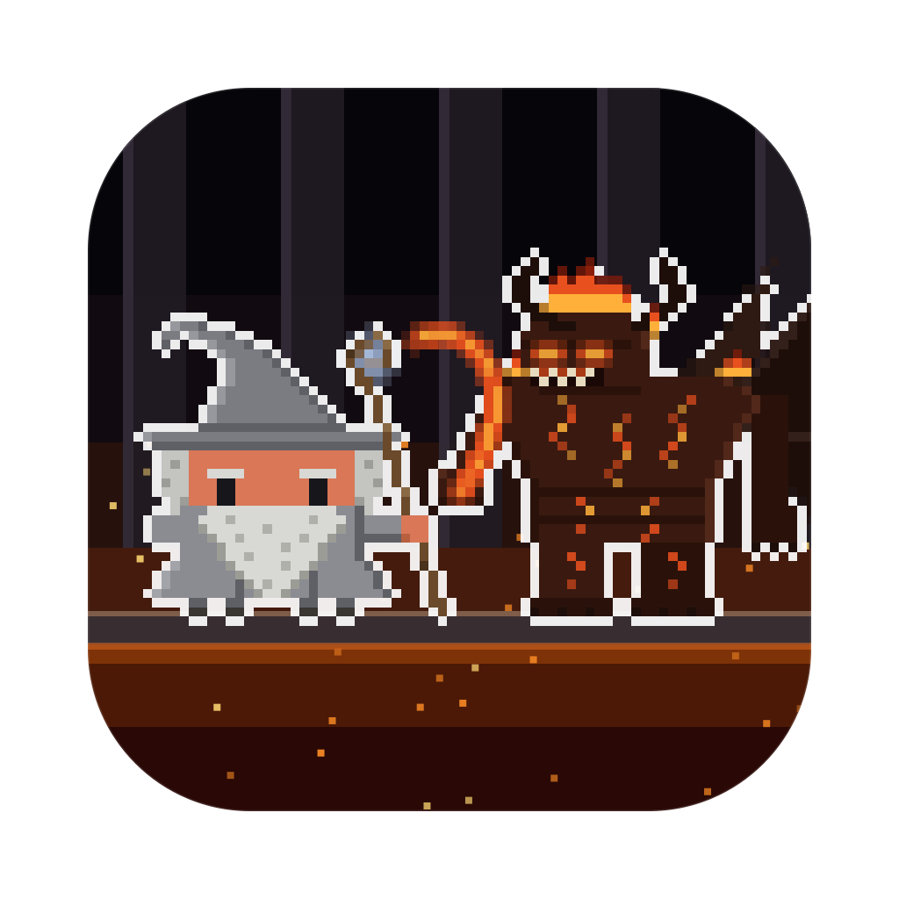
</p>

<h1 align="center">Clawd of the Rings</h1>

<p align="center">
  <b>Your AI coding sessions, as a pixel-art quest on your desktop.</b><br>
  Every session is a hero or a villain of Middle-earth, every subagent joins in, and they fight while they work.
</p>

<p align="center">
  <a href="LICENSE"></a>
  
  
  
  <a href="https://github.com/rodclemen/clawd-clash"></a>
</p>

https://github.com/user-attachments/assets/d733b9d3-9ca9-4781-b05f-7b20deea4dde

<p align="center"><sub>🔊 <b>Click the speaker in the player for sound</b>: GitHub starts videos muted. Full 1080p version: <a href="promo/clawd-of-the-rings-promo.mp4">promo/clawd-of-the-rings-promo.mp4</a></sub></p>

> **Clawd of the Rings is a universe of [Clawd Clash](https://github.com/rodclemen/clawd-clash).** Same crew, same fights, more universes to switch to. This page shows off the Clawd of the Rings universe; see [Get it](#get-it) to install.

<p align="center">
  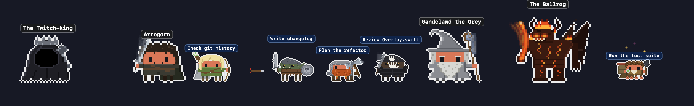
</p>

---

## Contents

- [What it is](#what-it-is)
- [The Clawd of the Rings universe](#the-clawd-of-the-rings-universe)
- [The cast](#the-cast)
- [Window mode](#window-mode)
- [Screen saver](#screen-saver)
- [Get it](#get-it)
- [More universes](#more-universes)
- [What's new](#whats-new)

## What it is

You run Claude Code in three terminals. One is thinking, one is waiting for your permission, one finished ten minutes ago and you didn't notice. You alt-tab around to find out.

**Clawd Clash tells you at a glance, without switching windows.** Every session becomes a character in a pixel-art quest, along the bottom of your screen or in a window of its own: Claude Code's, and those of the other AIs and harnesses Clawd Clash supports ([the full list](https://github.com/rodclemen/clawd-clash#supported-ais-and-harnesses)).

- ⚔️ **Working?** Your Claude swings its sword, its axe or its staff, looses arrows, or cracks a whip of fire.
- 💭 **Thinking?** A thought bubble.
- ❗ **Needs you?** A red `!`, and if you ignore it for a minute, it starts jumping up and down. It keeps asking until you answer; press Esc instead and it stands down.
- 😴 **Done and idle?** It stops fighting and passes the time with habits of its own: Frodough slips the Ring on and fades to a ghost, Samwise stirs his supper and holds up a potato (*"Po-tay-toes!"*), Leggolas surfs on a shield, Boromeme holds up a finger and thumb (*"One does not simply push to main."*), Smeagull hugs his precious and then argues with himself, and Elcron's cron job comes due. After a couple of minutes it sits down; after five it's asleep (zZz).
- 🧭 **Spawned subagents?** Every subagent gets to be a hobbit, an elf or a dwarf (or an orc, an Uruk or a wraith): they walk in one by one, each labelled with what it's doing, and leave when they finish.
- 🔍 **Hover** any character for the details: status, how long, the tool it's running, your last prompt.
- 🖱️ **Click** any of them to jump straight to that session's terminal or editor tab.

No dashboard to open, no tab to check. It's just… there. A wizard is never late.

## The Clawd of the Rings universe

Run two Claudes and they square off. Every character is Clawd (Claude Code's little pixel mascot) in costume, and the fights follow the weapons:

| Matchup | What happens |
|---|---|
| magic (the Necro-maintainer's dark fire, Barrow-write's cold chant) vs a bow or thrown fire | the archer gets hit |
| magic vs a sword, axe, staff, claws or fangs | the weapon catches it |
| a bow (or Denethrow's torch, Smaug's fire, the Web Crawler's silk) vs a sword, axe, staff, claws or fangs | shots fly, and each one gets knocked away into the sky |
| sword, axe, staff, claws or fangs vs the same | they close in and fight it out |
| bow vs bow | a proper shoot-out: they duck and the shots collide mid-air |
| odd one out | cheers the others on |

Wizard staffs are swung like swords, not fired: only the Necro-maintainer and Barrow-write cast magic. Tom Bombadev, Barliman Butterbug and the Master branch of Lake-town don't fight at all.

**Arch-enemies face off first.** Whenever a pair is on stage together, everyone else shuffles aside so the two of them can have it out: Gandclawd and the Ballrog, Frodough and Smeagull, Samwise and Shellob, Arrogorn and Sourun, Boromeme and the Uruk-Hi, Gimmie and Gorbage, Éowin and the Twitch-king, Gandclawd the White and Sarumanual, Faramirror and Denethrow, Thorin and Azog, Bard and Smaug, and more.

**The Great Eagle.** When an agent is done, it walks off, except for three: the Great Eagle swoops in for Gandclawd, Frodough and Samwise, as it did at Mount Doom, lands, lowers a wing for them to climb on and soars away.

<p align="center">
  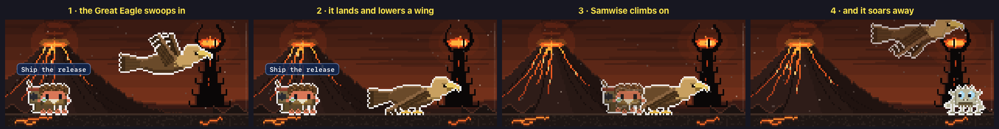
</p>

**One character, never twice.** Some characters come in two guises: Gandclawd the Grey and the White, Arrogorn and Stride-r, Sarumanual and Sharkey, Sourun and the Necro-maintainer. They're never on screen together. The casting never picks the other guise of someone already there, and if switching universe brings both on anyway, the later one is shown as someone else on the same side (the same someone every time).

**Smaug stays on his hoard.** Smaug the Stashed only ever appears on his gold in the Lonely Mount-point. Anywhere else, and on the desktop, he's shown as someone else, so a dragon never squeezes into the Prancing Ponytail.

**The Ring.** Now and then Frodough lifts the chain out from his shirt, slips the Ring onto his finger and is gone: only a faint ghost with a shimmering outline is left, and a few sparkles in the air, until he takes it off and fades back in.

<p align="center">
  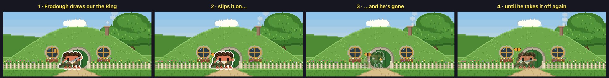
</p>

**Shellob's climb.** Shellob's signature doesn't stay in the picture: a thread shoots up to the top of your screen, she climbs it out of sight, and a moment later drops back down on it to dangle there, fangs spread.

<p align="center">
  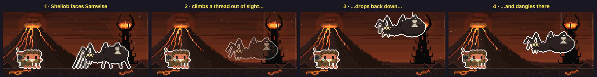
</p>

**Heroes against villains.** Run Claude Code alongside another AI and they pick sides: Claude Code plays the heroes, the others the villains, and each one's agents fight for their own side. The outline colour round each character tells you which AI it belongs to.

## The cast

38 villains and 37 heroes (plus one rare guest), any of whom can be a session (drawn large) or an agent (drawn small), from The Lord of the Rings and The Hobbit. Every one of them has a signature move and an arch-enemy.

**The heroes**: Gandclawd the Grey (slams his staff down, *"You shall not pass!"*), Gandclawd the White (his staff bursts into blinding light), Frodough Bagclawds (slips the Ring on and fades away), Samwise Gamjee (*"Po-tay-toes!"*), Pippin Tookmuch (can't help nudging the bucket down the well), Merge-y Brandybranch (blows the horn-call of the Shire), Bilbyte Bagclawds (unrolls the Dwarves' contract right across the floor), Rosie Kotlin (tosses the flower from her hair) and Farmer Mag-git (shakes his pitchfork while his dog Fang barks); Arrogorn (kicks an orc helmet, and then the pain arrives), Stride-r (blows smoke rings), Leggolas (surfs on a shield), Gimmie, son of Groan (*"Nobody tosses a dwarf!"*) and Boromeme (*"One does not simply push to main."*); Gladriel (raises the Phial), Elcron (his cron job comes due), Arwen Undoable (calls up the flood of the Bruinen), Glorfind (shines with his radiant form), Haldirectory (holds an arrow on you, dead steady), Celeborne-again (golden leaves swirl round him), Thrandual (*"I do not duel. I dual-wield."*) and Radagast the Brownfield (a robin lands on his hat); King Théodone (*"Forth, Eorlingas!"*), Éowin (*"I am no manager!"*, her helmet off and her hair spilling free), Éomore (a pager's "--More--" pops up over his head) and Faramirror (his mirror image copies him a beat behind); B-Treebeard (a very, very slow hrum), Quicksort (sorts his rowan berries round a pivot), Tom Bombadev (dances a jig) and Barliman Butterbug (remembers the letter he forgot to send); Thorin Oakenshell (raises Orcrist and the Arkenstone), Load Balin-cer (round-robin, one tick each), Kill-i (*kill -9*), File-i (spins both swords), Groan (rubs his back, then shows off a locket of Gimmie), Bard the Bowmanpage (aims the Black Arrow at the sky) and Beorn the Bearer-token (turns into a bear and back). And now and then HEM turns up in Rohan's helmet, mail and sun-horse shield, and the helmet comes off to let the buns out.

**The villains**: Sourun (the Eye opens over his helm, *"One Ring to rule them all."*), Sarumanual (gazes into the palantír), the Necro-maintainer (comes apart into smoke round the Eye) and Sharkey (throws a tantrum); the Twitch-king (shrieks), Nazgulp (sniffs out *"Bagclawds… Shire…"*), the Ballrog (rears up and cracks its whip of fire), Smeagull (*"My precious!"*, then argues with himself) and Shellob (climbs her thread out of sight); the Uruk-Hi (*"Meat's back on the menu!"*), Lintz (looses three arrows at once), Ug-lookup (his list of prisoners unrolls along the floor), Grish-NaN (searches their pockets: NaN), Shagradle (shows off the mithril shirt on his sword), Gorbage (drums on a bin lid, *"Collecting garbage!"*), Olog-HA (shakes the ground), the Cave Troll-ing (*"u mad?"*), Gothmock (his one good eye bulges), the Mouth of Sourun (his grin stretches wider and wider), Wargh-rider (the warg howls), the Oli-PHP-aunt (trumpets a little "PHP"), Harad-RAM (charges like a ram), the Eastereggling (finds an easter egg), the Cursor of Umbar (slashes a blinking cursor in two, and it comes right back) and the King of the Dead Code (fades away to two pinpricks of light and laughs); Grep-ma Wormtongue (whispers), Denethrow (eats a cherry tomato while Pippin sings), the Watcher in the Waterfall (a tentacle rears up and slaps down), Barrow-write (chants while its hand crawls off along the floor), Old Man Pillow (a huge, slow yawn), Lotho Sackville-Bagclawds (counts his takings) and Bill Firmware (hurls an apple); Smaug the Stashed (*"I am fire, I am death!"*), Azog the Profiler (roars), Blog, son of Azog (writes a new post, and the likes come in), the Go-blin King (sings, beating time with his staff), the Mirkwood Web Crawler (wraps a dwarf in silk) and the Master branch of Lake-town (counts his cut and takes a long swig).

<p align="center">
  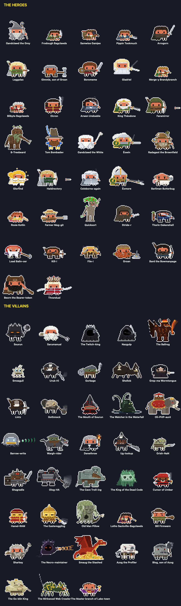
</p>

## Window mode

Clawd Clash opens in a window by default (switch to the desktop from the menu). The whole crew stands in a scene, and every session gets a card: its project, what it's doing right now, your last prompt, its last reply, and its agents in a little tree underneath.

<p align="center">
  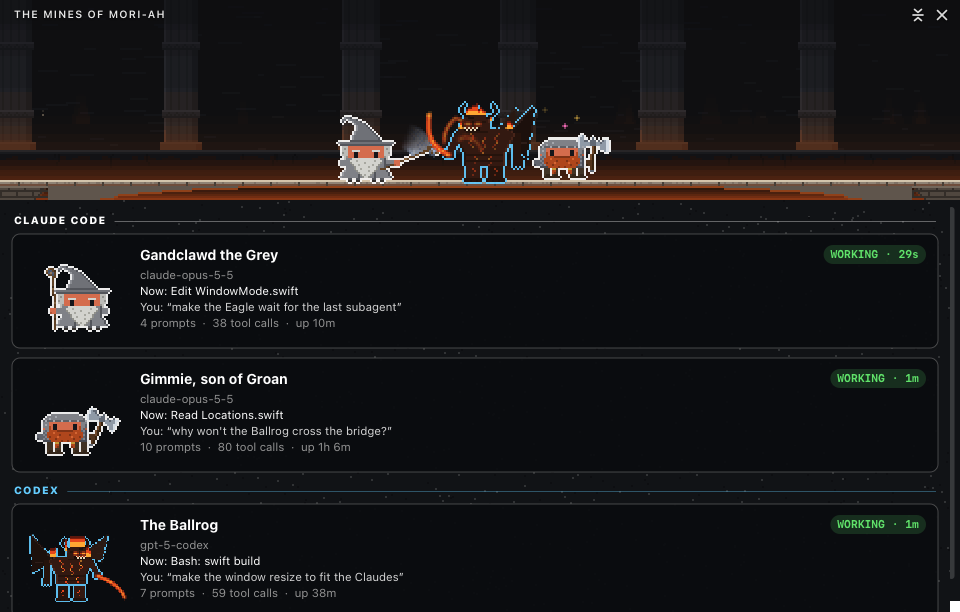
</p>

The scene is set **where the first session's character belongs**: Bag Endpoint for Frodough and Samwise, the Mines of Mori-ah for Gandclawd, Helm Chart's Deep for Arrogorn and Gimmie, Rivendev for Elcron, Mount Doomscroll for Sourun and Shellob, the Lonely Mount-point for Thorin's company:

<p align="center">
  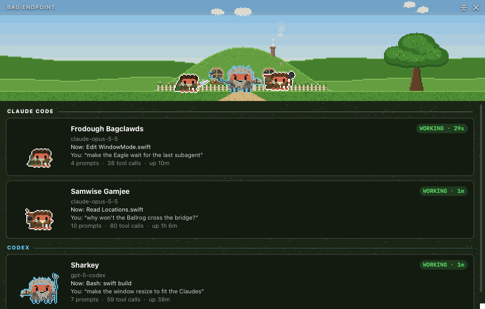
</p>

22 hand-built places, each with its own little animation: smoke puffs from the chimney at Bag Endpoint; the fire flickers in the Prancing Ponytail's hearth; the glow from the depths swells and ebbs in the Mines of Mori-ah; the Eye looks left and right over Mount Doomscroll; the waterfalls pour down in Rivendev; golden leaves drift down in Lothlorem; the banners stream over the Golden Hall of Edit-oras; the rain falls and lightning flares over Helm Chart's Deep; the pits' fires lick up in Isengit; a bird circles the White Tower of Minas Tiered; corpse-lights wander over the Dead Merges; the cage swings on its chain in Go-blin Town; a coin slithers down Smaug's hoard in the Lonely Mount-point; the sign sways in the evening breeze at the Green Dragon-and-Drop.

<p align="center">
  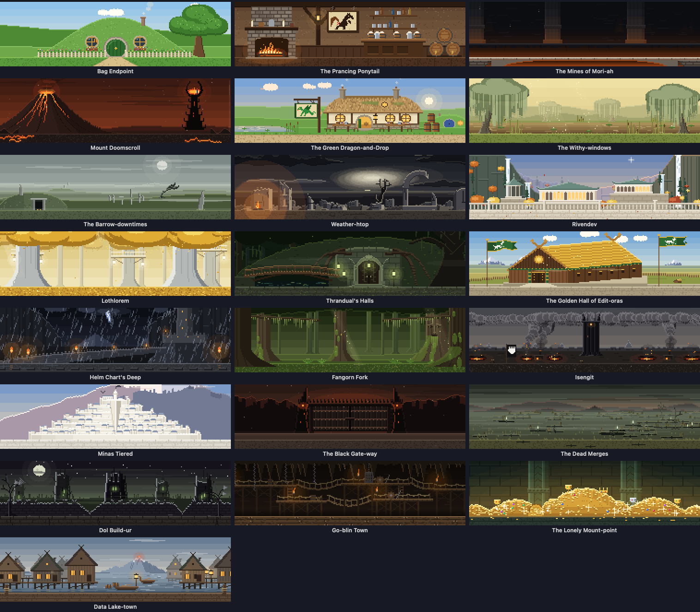
</p>

When the scene moves somewhere new, it goes the way the books would: the lidless Eye opens and its pupil swallows the frame; the old place yellows into the map, and a dotted line walks from where the crew was to where it's going; the Red Book's page turns to the new place; a Great Eagle carries the view away; the Ring goes on and the world turns wraith-grey; the beacons of Gondor light from peak to peak; the new place surfaces in Gladriel's Mirror; one of Gandclawd's rockets bursts into a fiery dragon; and a palantír clouds over and clears. Each comes up more often with its own people on screen, or when it's heading for its own part of the map.

<p align="center">
  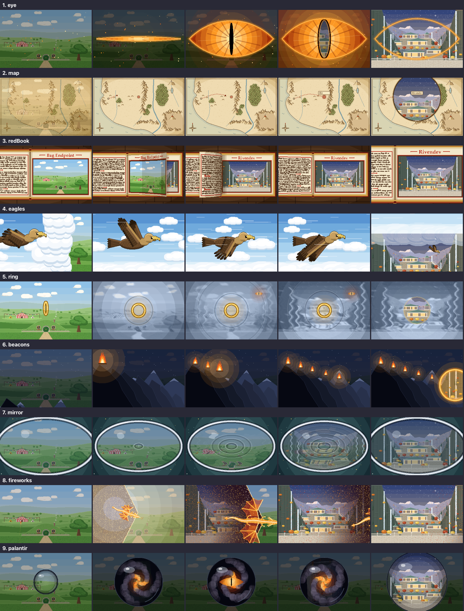
</p>

## Screen saver

<p align="center">
  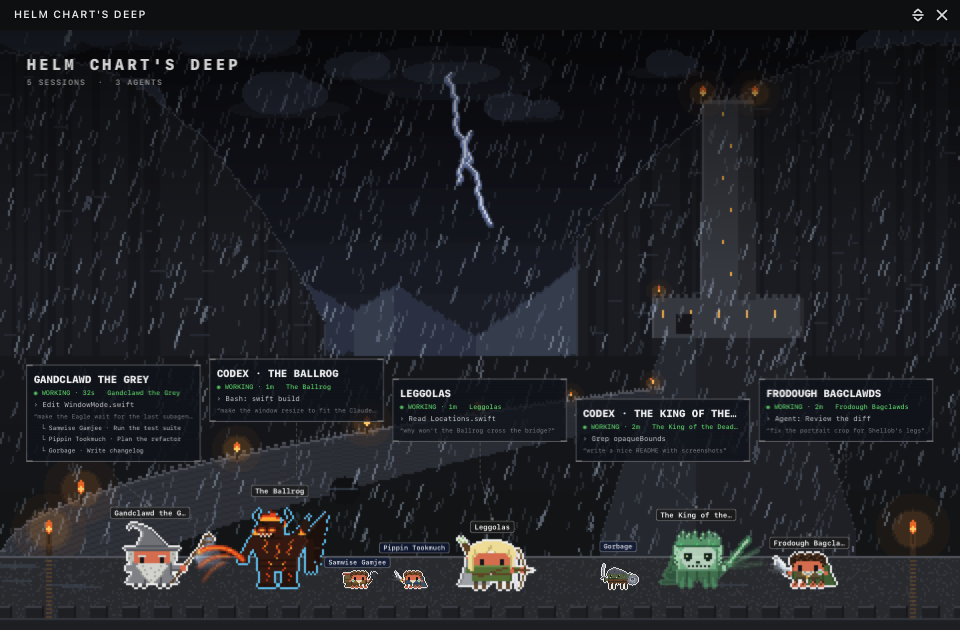
</p>

Clawd Clash comes with a screen saver: the place at full screen and the crew fighting across its floor. Every Claude and agent wears a name tag, each session has a card floating above the crew, a clock sits in the corner, and what happened lately crawls along the bottom. Every 10 minutes it travels somewhere new with one of the transitions above. When there's nothing much to watch, it puts on a show instead: a random crew squaring off, heroes against villains. It even shows your sessions with the app closed. Pick **Clawd of the Rings** in the screen saver's **Options…** in System Settings.

The window can show the same view, and **Random** location moves the window somewhere new every 10 minutes, the same way.

## Get it

Clawd of the Rings is part of **[Clawd Clash](https://github.com/rodclemen/clawd-clash)**, one app with multiple universes. It needs macOS 13+ and at least one of the [AIs and harnesses it supports](https://github.com/rodclemen/clawd-clash#supported-ais-and-harnesses).

Clawd of the Rings isn't released yet. When it is, it comes with the next Clawd Clash release:

```sh
brew tap rodclemen/tap
brew trust rodclemen/tap      # newer Homebrew asks you to trust a third-party tap once
brew install --cask clawd-clash
```

Then pick **Settings → Universe → Clawd of the Rings** (already have Clawd Clash? `brew upgrade --cask clawd-clash`). Or download the zip from [Clawd Clash's releases](https://github.com/rodclemen/clawd-clash/releases), unzip it and drag **Clawd Clash** to Applications.

Everything else (how it works, the settings, uninstalling, the source and contributing) lives in the **[Clawd Clash repo](https://github.com/rodclemen/clawd-clash)**.

## More universes

Clawd of the Rings is one of multiple universes. In **Settings → Universe** you can switch to **[Star Clawds](https://github.com/rodclemen/star-clawds)**, **[Marvelous Clawds](https://github.com/rodclemen/marvelous-clawds)**, **[Detective Clawds](https://github.com/rodclemen/detective-clawds)**, **[Doctor Clawd](https://github.com/rodclemen/doctor-clawd)**, **[The Clawd Files](https://github.com/rodclemen/the-clawd-files)** or **[Stevie Clawdberg](https://github.com/rodclemen/stevie-clawdberg)**, or pick **Random** to change universe on its own every so often. Switching recasts everyone on screen and moves the scene to one of the new universe's places. Or pick **Clawd Royale** to throw every cast into one scene, each character as themselves, in a new place from any universe every ten minutes.

## What's new

The highlights, in plain words: [CHANGELOG.md](CHANGELOG.md). The full history lives in Clawd Clash.

---

<p align="center"><sub>An independent parody fan project, not affiliated with or endorsed by the Tolkien Estate, the Tolkien Trust, Middle-earth Enterprises, New Line Cinema, Warner Bros. or the makers of any of the books or films. Claude and Clawd belong to Anthropic.<br>Free to use: <a href="LICENSE">MIT licensed</a>.</sub></p>
